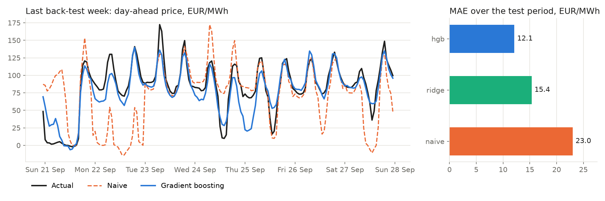

# Day-ahead power price forecasting

[](https://github.com/matthieu-briche/power-price-forecasting/actions/workflows/ci.yml)

End-to-end machine-learning pipeline that forecasts **hourly day-ahead electricity prices**
(German-Luxembourg bidding zone, DE-LU) and evaluates the forecasts both statistically and
**economically**, through a battery trading strategy settled at realised prices.

It covers the whole model lifecycle (data ingestion, feature engineering, training,
walk-forward back-testing, persistence and reporting) with production practices: typed
Python package, MongoDB storage, Docker, GitHub Actions CI and leakage tests.



> **Headline numbers come from real DE-LU market data** (Energy-Charts, 2023 – Sept 2025,
> last 178 days held out). The fundamentals used as features are *realised* load, wind and
> solar rather than day-ahead forecasts, which flatters every model a little (see
> [Data](#data)). Results on the bundled synthetic dataset are given for reference.

---

## Why this problem

Day-ahead auction prices are the anchor of European short-term power trading. They are
driven by **residual load** (load minus wind and solar) through a convex merit-order curve,
have strong daily and weekly seasonality, **negative prices** when renewables flood the
system and **spikes** in scarcity hours. That makes them a good test bed for time-series
ML: heavy tails, regime changes and a strict information set.

## Pipeline

```
 Energy-Charts API ─┐                     ┌─> naive benchmark ─┐
 (prices, load,     ├─> MongoDB ─> features ─> ridge (LEAR-like) ├─> walk-forward ─> metrics ─> MongoDB
  wind, solar)      │  market_data          └─> gradient boosting┘   back-test       + trading   runs / forecasts
 synthetic generator┘                                                                 PnL
```

| Module | Role |
|---|---|
| `data/energy_charts.py` | Downloads DE-LU day-ahead prices and load / wind / solar, resamples the 15-min MTU (since Oct 2025) to hourly. |
| `data/synthetic.py` | Realistic synthetic market (merit order, seasonality, negative prices, spikes) for tests and offline demos. |
| `features.py` | Calendar, fundamentals, residual load, D-1/D-2/D-7 price lags, D-1 daily statistics. DST-safe. |
| `models.py` | Naive EPF benchmark, ridge regression with hour/day one-hot encoding, histogram gradient boosting (L1 loss). |
| `backtest.py` | Daily walk-forward evaluation with a rolling training window and periodic retraining. |
| `trading.py` | One-cycle-per-day battery strategy; PnL and capture ratio versus perfect foresight. |
| `storage.py` | Idempotent MongoDB upserts, run tracking, server-side aggregation of errors by hour. |
| `cli.py` | `powerfc ingest` and `powerfc backtest`. |

## Design choices

**Respecting the information set.** The auction for day D closes at 12:00 on D-1. Every
price feature for day D therefore uses only prices from D-1 or earlier.
`tests/test_features.py` enforces this with a perturbation test: adding +1000 EUR/MWh to
every price from day D onwards must leave day D's features unchanged. A second test spies on
`fit()` to prove that no model is ever trained on the day it forecasts.

**A proper benchmark.** Models are compared with the standard naive benchmark of the
electricity price forecasting literature (same hour on D-1 for Tuesday to Friday, D-7 for
Monday and the weekend), and errors are reported as **rMAE** (MAE relative to naive), as
recommended by Lago et al. (2021). Plain MAPE is not used because it breaks on zero and
negative prices; sMAPE is reported instead.

**Robust loss.** Gradient boosting is trained with an absolute-error loss: price spikes
would otherwise dominate a squared-error fit.

**Forecast value, not just forecast error.** A forecast is only as good as the decisions
it drives. `trading.py` picks a charge window and a later discharge window from the
*forecast* curve each day, then settles them at *realised* prices. Two models with similar
MAE can differ a lot in capture ratio, because what matters is ranking the cheap and
expensive hours correctly.

## Results

### Real market data (DE-LU, 178-day walk-forward test ending Sept 2025)

| Model | MAE (EUR/MWh) | RMSE | sMAPE | rMAE vs naive | Battery PnL (EUR) | Capture ratio |
|---|---:|---:|---:|---:|---:|---:|
| Naive | 23.0 | 36.4 | 57.1% | 1.00 | 40,939 | 94.3% |
| Ridge | 15.4 | 21.8 | 44.1% | 0.67 | **42,548** | **98.0%** |
| Gradient boosting | **12.1** | **19.7** | **41.6%** | **0.53** | 42,336 | 97.5% |

What the real data shows:

* **Gradient boosting halves the naive error** (rMAE 0.53) and has the lowest MAE and RMSE.
* **Lowest error is not highest PnL.** Ridge captures more of the perfect-foresight battery
  PnL than gradient boosting despite a 27% higher MAE: the battery only needs the cheap and
  expensive hours ranked correctly, not the price level.
* **The naive benchmark already captures 94% of the PnL**, because the daily price shape
  repeats from one day to the next. The models' value lies in the remaining 6%.
* **sMAPE is high for every model** because of hours with prices near zero or negative,
  where relative errors explode; rMAE is the metric to compare.

Reproduce with `make real && make plot-real` (needs internet; about 10 minutes, the API is
rate-limited).

### Synthetic data (179-day walk-forward test)

| Model | MAE (EUR/MWh) | RMSE | sMAPE | rMAE vs naive | Battery PnL (EUR) | Capture ratio |
|---|---:|---:|---:|---:|---:|---:|
| Naive | 53.0 | 68.3 | 43.8% | 1.00 | 26,534 | 71.9% |
| Ridge | 17.3 | 21.8 | 18.1% | 0.33 | 35,635 | 96.6% |
| Gradient boosting | **15.1** | **20.1** | **13.1%** | **0.29** | **36,031** | **97.6%** |

The synthetic fundamentals are perfect "forecasts" and the price is generated from them, so
errors are far smaller than on real data. Reproduce offline with `make backtest && make plot`.

Settings for both: 365-day rolling training window, weekly retraining, 1 MW / 2 MWh battery
with 90% round-trip efficiency.

## Quick start

```bash
make install                 # pip install -e ".[dev]"
make test                    # unit tests, incl. leakage tests
make backtest                # synthetic data -> reports/
make real                    # real DE-LU data from Energy-Charts (needs internet)
```

Full pipeline with MongoDB through Docker Compose:

```bash
docker compose up --build --abort-on-container-exit pipeline
SOURCE=energy-charts docker compose up --build pipeline     # real data
```

CLI examples:

```bash
powerfc ingest   --source energy-charts --start 2023-01-01 --days 1000 --mongo-uri mongodb://localhost:27017
powerfc backtest --source mongo --mongo-uri mongodb://localhost:27017 --models naive ridge hgb --test-days 180
```

## Data

* **Real:** [Energy-Charts API](https://api.energy-charts.info/) (Fraunhofer ISE), free and
  without an API key. It provides day-ahead prices for DE-LU and *realised* load, wind and
  solar. A live system would use the TSO **day-ahead forecasts** of these fundamentals
  (ENTSO-E Transparency Platform); using realised values is a known optimistic bias, kept
  explicit here.
* **Synthetic:** `generate_synthetic()` builds two years of hourly data with daily and
  weekly load profiles, seasonal solar with daily cloudiness, persistent wind regimes, a
  random-walk fuel price and a convex merit order. It lets the tests and the CI run offline
  and deterministically.

## CI/CD

GitHub Actions (`.github/workflows/ci.yml`):

1. **lint-test**: ruff (lint and format) and pytest with coverage on Python 3.11 and 3.12.
2. **integration**: the full `scripts/run_pipeline.sh` (ingest, then back-test) against a
   real MongoDB 7 service container; the report is uploaded as a build artifact.
3. **docker**: builds the image and runs a smoke back-test inside it.

## Roadmap

- [ ] ENTSO-E day-ahead load / wind / solar forecasts instead of realised values
- [ ] Fuel and carbon prices (TTF gas, EUA) as exogenous features; public holidays
- [ ] LEAR model (LASSO on 24 hourly models) and hyper-parameter search on a validation window
- [ ] Probabilistic forecasts (quantile regression) and pinball loss; Diebold-Mariano tests
- [ ] 15-minute granularity and intraday (continuous) market
- [ ] Model registry and experiment tracking (MLflow)

## References

* J. Lago, G. Marcjasz, B. De Schutter, R. Weron (2021). *Forecasting day-ahead electricity
  prices: A review of state-of-the-art algorithms, best practices and an open-access
  benchmark.* Applied Energy 293.
* R. Weron (2014). *Electricity price forecasting: A review of the state-of-the-art with a
  look into the future.* International Journal of Forecasting 30(4).

## License

MIT
